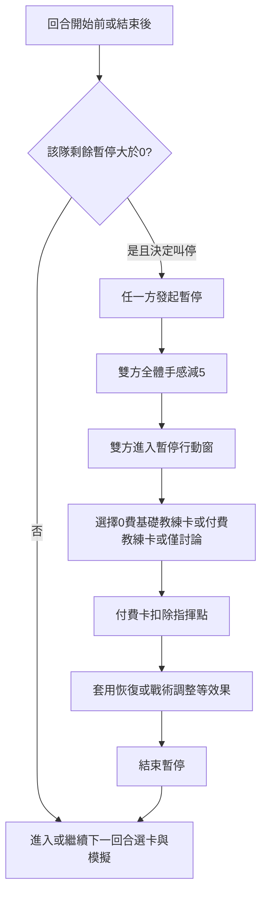

# 聚焦卡 · 教練卡 · 手感與暫停

本文件為權威設計規格。資料源：

- [`focus_cards.json`](../Data/JSON/focus_cards.json)
- [`coach_cards.json`](../Data/JSON/coach_cards.json)
- 規則常數：`FormRules`、`TimeoutRules`（`TacticalCardDomain.cs`）

執行層已接入 Demo 回合管線（暫停／教練／聚焦選卡、手感新規結算）。本文件仍為規則權威；JSON 為卡表來源。導入請跑 `Tactica Universalis > Import JSON Content`。

---

## 卡牌顏色標記（同戰術卡）

依 `teamScope` 上色，與戰術卡 picker 一致：

| teamScope | 視覺 | 條帶標籤 |
|-----------|------|----------|
| `universal` | 鋼藍灰邊框／冷色面 | 通用 |
| `navi_2021` / `gambit_2021` | 銅色邊框／暖色面 | 專屬 |

0 費基礎教練卡亦為 `universal`（通用色），並以 tag `base` 區分。

---

## 第一部分：聚焦卡

### 定位

- 回答：**這一回合把球傳給誰**。
- 戰術卡＝全隊宏觀基底；聚焦卡＝個人／組合資源傾斜，**疊加**在戰術卡之上。
- 效果可強於戰術卡個人向加成，但常附風險或使用限制。

### 結構欄位

見 `FocusCardDefinition`：卡名、指揮點 1–3、tags、一句話效果、`targetMode`（auto/manual/duo/team）、屬性參數、`specialRuleKey`、`duration`、`synergyTacticalCardIds`。

### NAVI 聚焦卡（4）

| 卡名 | 費 | 標籤 | 對象 | 效果摘要 | 特殊規則 |
|------|---|------|------|----------|----------|
| 把這局交給我 | 3 | star, risky | s1mple | 全屬性 +28%，首殺／殘局微增 | `s1mple_focus_death_penalty`：陣亡→全隊心態 −12、手感 −10 |
| 雙子星連線 | 2 | duo, star | s1mple+electronic | 各全屬 +12%＋瞄／反微增 | `gemini_same_zone_link`：同區配合 +18% |
| B1T的成長 | 1 | growth, star | b1t | 全屬 +14%＋開局 | `b1t_growth_diminishing`：第 n 次本場使用，數值 × max(0.4, 1−0.2×(n−1)) |
| Perfecto的冷靜 | 1 | recovery, star | perfecto | 心態 +20，清負面；殘局 +12% | `perfecto_cleanse_clutch` |

### 紅星（Gambit）聚焦卡（4）

| 卡名 | 費 | 標籤 | 對象 | 效果摘要 | 特殊規則 |
|------|---|------|------|----------|----------|
| 相信體系 | 2 | team | 全隊 | 配合 +16%、溝通 +10% | `system_team_boost` |
| sh1ro的耐心 | 2 | star, info | sh1ro | 首殺 +14%；位置對敵方資訊模糊 | `sh1ro_fog_of_war`：敵方 HUD／推斷無法可靠鎖定 sh1ro 區 |
| Hobbit的傳承 | 1 | growth, star | 手動（Ax1Le/interz/nafany） | 對象意識 +18% | `hobbit_legacy_transfer` |
| interz的潤滑 | 1 | team, star | interz | interz 配合視同翻倍（資料層 +20%） | `interz_support_aura`：同區隊友失誤率下降 |

---

## 第二部分：教練卡與暫停

### 定位

- 僅在**暫停期間**使用（`timing: timeout`）。
- 回答：**這個暫停我們能做什麼來改變局勢**。

### 暫停次數

| 階段 | 每隊次數 |
|------|----------|
| 常規時間 | 3 |
| 加時賽 | 雙方各再 +1 |

### 暫停副作用

- **每次**暫停（無論哪方發起）：**雙方全體手感 −5**（`TimeoutRules.BothTeamsFormPenalty`）。
- 對方暫停時，我方亦可使用教練卡（含 0 費基礎卡）。

### 0 費基礎教練卡（通用，3）

| 卡名 | 效果 | 副作用 |
|------|------|--------|
| 補充心態 | 指定選手心態 +15 | 該選手手感 −3 |
| 補充體力 | 指定選手體力 +20 | 該選手手感 −3 |
| 基礎喊話 | 全隊心態 +5 | 無 |

### 通用付費教練卡（4）

| 卡名 | 費 | 效果 |
|------|---|------|
| 全面激勵 | 3 | 全隊心態 +18 |
| 體力注入 | 2 | 全隊體力 +25 |
| 戰術重構 | 2 | 可更換本回合已打出的戰術卡 |
| 關鍵專注 | 2 | 指定選手手感 +15、心態 +10 |

### 專屬教練卡

| 隊伍 | 卡名 | 費 | 效果 |
|------|------|---|------|
| NAVI | B1ad3的戰術洞察 | 3 | 揭示對手本回合最可能戰術傾向，並可更換己方戰術卡（每場最多 2 次） |
| 紅星 | groove的體系調整 | 3 | 全隊配合 +12%、心態 +8，並清除全隊負面狀態（每場最多 2 次） |

---

## 第三部分：手感完整數值變動規則

手感（Form）範圍 **10–95**。戰鬥換算：相對基準 50 的差值夾在 **−10 ～ +15**，直接加減瞄準與反應（見 `FormRules.AimReactionDelta`）。

### 開局

- 每場每位選手：於 **50–70** 均勻隨機。

### 上升

| 事件 | 變動 |
|------|------|
| 擊殺 | +5～+10（隨機） |
| 同一回合第 2+ 殺 | 每多一殺額外 +3 |
| 贏得殘局（存活決出勝負） | +15 |

### 下降

| 事件 | 變動 |
|------|------|
| 陣亡 | −5～−10（隨機） |
| 被首殺（本回合首名陣亡） | −15（取代一般陣亡下限，不疊加） |
| ECO／Light 回合結束且本隊落敗 | 全隊 −5 |
| **任一方叫暫停** | **雙方全體 −5** |

### 與現行 Demo 實作差異（待對齊）

現行 sim 大致為擊殺 +4～8／陣亡 −4～8／回合結束向 50 緩漂移。接入本規格時應改為上表，並移除或降權與本規則衝突的漂移項。

---

## 聚焦卡 × 戰術卡協同關係表

加成各自結算後再夾戰術卡既有上限；聚焦卡全屬性不受戰術卡火力上限直接截斷，但同屬性維度最終進戰鬥前仍受系統總 clamp（實作時另定）。下表標示**設計協同**（資料欄 `synergyTacticalCardIds`）。

| 聚焦卡 | 強協同戰術卡 | 協同說明 |
|--------|--------------|----------|
| 把這局交給我 | 神狙支點、激進前壓、鋼鐵紀律 | 明星回合最大化；紀律防守下的個人窗 |
| 雙子星連線 | 雙星破陣、聲東擊西、激進前壓 | 雙核破點／轉點連線 |
| B1T的成長 | 新星試煉、ECO 絕境快攻、激進前壓 | 低費年輕人破點線 |
| Perfecto的冷靜 | 完美殘局、穩扎穩打、鋼鐵紀律 | 拖節奏進殘局 |
| 相信體系 | 紅星同步、紅星鐵壁、穩扎穩打 | 體系基底再抬一層 |
| sh1ro的耐心 | sh1ro 穩健架槍、中路情報網、紅星鐵壁 | 隱匿 + 資訊不對稱 |
| Hobbit的傳承 | Hobbit 老將讀局、Ax1Le 無聲滲透、中路情報網 | 情報／滲透對象強化 |
| interz的潤滑 | 紅星同步、紅星鐵壁、穩扎穩打 | 補槍網中心 |

**不建議疊加（反協同，設計提示）：**

- 「把這局交給我」+ 過度依賴殘局的 Perfecto 專精線（資源哲學衝突）。
- 「相信體系」+ 純個人豪賭聚焦（NAVI 明星卡）：可合法疊加但主題互相稀釋。
- 「B1T的成長」在本場第 4+ 次：收益過低，應改打教練／戰術層。

---

## 暫停機制完整流程

### 步驟說明

1. **發起時機**：在該回合**對戰播放期間**按底欄「叫暫停」，預約下回合暫停（立即扣除 1 次額度）。
2. **進入暫停窗**：下一回合開局（抽牌／選經濟前）若有預約，先進入教練暫停窗，並立即套用雙方手感 −5。
3. **窗內行動**：選教練卡立即生效；按「確定」結束，或按「跳過」不使用更多教練卡直接結束。
4. **對手**：進入暫停窗時，對手自動使用一次「基礎喊話」。
5. **之後**：再進入經濟卡 → 戰術卡 → 聚焦卡 → 模擬。

控制列「暫停／繼續」僅控制播放快慢，與戰術暫停無關。

---

## 與戰術卡流程的相對位置（已接入 Demo）

每回合管道：

1. （若上回合有申請）教練暫停窗  
2. 經濟卡  
3. 戰術卡（全隊基底）  
4. 聚焦卡（個人／組合疊加）  
5. 回合模擬；模擬播放中可按「叫暫停」預約下回合暫停  

指揮點與戰術卡共用池；戰術鎖定後再扣聚焦費用。對手在暫停窗開啟時會自動使用一次「基礎喊話」，並在開戰前 AI 選擇聚焦卡。
