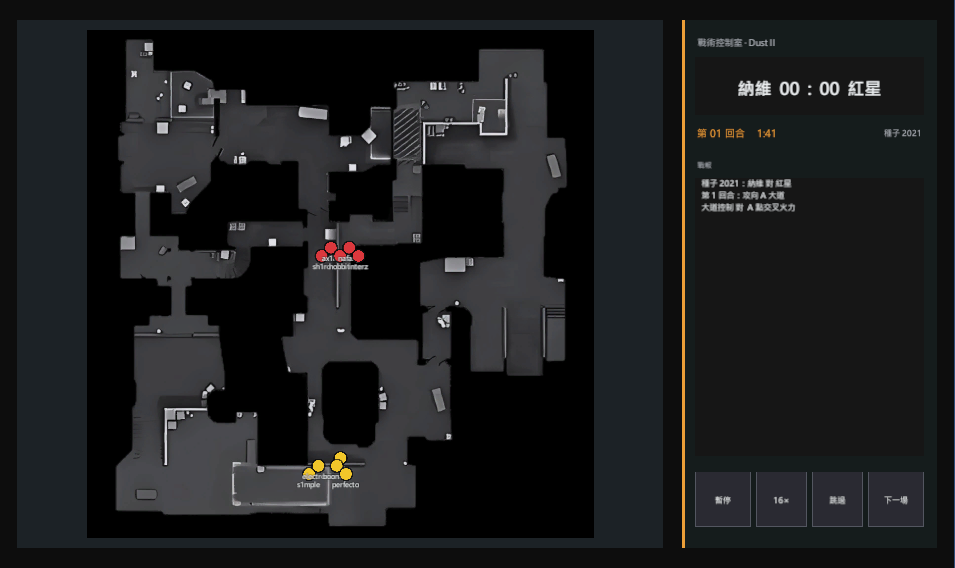

# Tactica Universalis

2021 賽季的電競俱樂部經營，加上可以進入的戰術對局。這是 Unity 6 的個人作品，目前仍在開發，公開這個倉庫是為了作品集。

A work-in-progress club management game with a playable tactical match layer.

## 現在玩得到什麼

- 生涯從選擇俱樂部開始，以週為單位推進，處理經濟、選手、教練、贊助與賽程。
- 比賽日可以進入戰術對局，在 Dust II 看這一分怎麼打，並能暫停、調整倍速或跳過。
- 規則、選手、賽事與地圖資料放在 JSON。存檔只記狀態，不把靜態設定寫死在存檔裡。

規則、介面與平衡都還在修。倉庫裡是目前的開發版本，不是完成品。

## 程式怎麼分

| 層 | 路徑 | 做什麼 |
| --- | --- | --- |
| Domain | `Assets/_Project/Scripts/Domain` | 規則與資料，不依賴 Unity |
| Application | `Assets/_Project/Scripts/Application` | 把一週、一場比賽的流程串起來 |
| Infrastructure | `Assets/_Project/Scripts/Infrastructure` | 讀 JSON、存檔 |
| Presentation | `Assets/_Project/Scripts/Presentation` | 生涯與對局畫面 |

編輯模式測試在 `Assets/_Project/Tests/EditMode`。

## 在 Unity 裡打開

1. 安裝 Unity `6000.0.48f1`。
2. 用 Unity Hub 開啟這個資料夾。
3. 生涯場景是 `Assets/_Project/Scenes/Demo_Career.unity`。
4. 對局場景是 `Assets/_Project/Scenes/Demo_Dust2_QuickSim.unity`。

Unity 會自己重新產生解決方案與專案檔。那些檔帶有這台電腦的路徑，所以沒有放進倉庫。

## 沒有放進倉庫的東西

- `Library`、`Temp`、`Logs` 與其他編輯器快取。
- 選手資料抓取的程式與原始快取。
- 下載來的地圖碰撞與預覽。
- 編輯器備份、本機代理筆記，以及示範字型 Anuschka Demo。遊戲會改用介面字型。

## 第三方名稱與素材

俱樂部、選手與地圖名稱屬於各自的權利人。這是非官方的個人作品，與 Valve、賽事主辦方和任何俱樂部無關。

請勿再散布倉庫裡的雷達圖、選手資料，或把這些名稱當成可以轉授權的內容。

隨專案提供的字型是 Noto Sans TC、Anton 與源樣明體，各自依原授權使用。

## 授權

這個倉庫沒有開放原始碼授權。公開是為了展示與閱讀程式，不表示可以拿去改作或再發布。

## 作者

Shang-Jing Lyu · [MoYan1250](https://github.com/MoYan1250)
